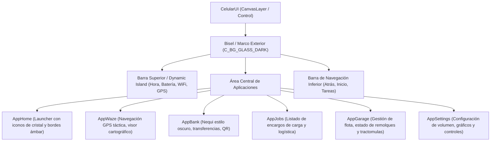
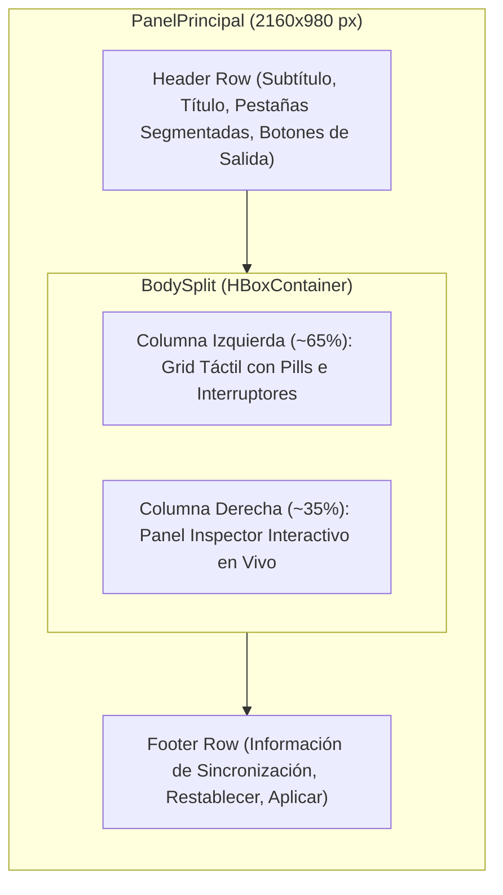

# Sistema de Diseño UI: Nuestra Tierra 2.0 (Glassmorphism Automotriz)

Este documento define el **Sistema de Diseño e Identidad Visual Oficial** para todas las interfaces de usuario (UI), HUDs vehiculares, dispositivos inteligentes (*Celular / Tablet*) y paneles modales del proyecto **Nuestra Tierra 2.0** en Godot 4.

El estilo visual principal está unificado con la estética de cabina y telemetría de **`UIVehiculo`** y la interfaz digital de **`CelularUI`**, garantizando coherencia en ambientación, paleta de color, legibilidad móvil y sensación táctil.

---

## 1. Filosofía Visual: Glassmorphism Automotriz

El concepto estético combina:
1. **Cristal Esmerilado de Alta Densidad (Smoked Dark Glass):** Fondos semitransparentes en carbón y pizarra oscura (`Color(0.06, 0.07, 0.08, 0.85 - 0.95)`) que permiten vislumbrar sutilmente el mundo 3D o el fondo sin perder contraste de lectura.
2. **Bordes Metálicos Glaseados Finos (1px Frost Line):** Bordes sutiles y elegantes (`1px`) con tinte metálico gélido (`Color(0.78, 0.81, 0.85, 0.20 - 0.28)`), reemplazando los bordes gruesos de neón sobresaturado.
3. **Acento Ámbar Instrumental (Amber Cockpit Glow):** Acentos en tono ámbar dorado (`Color(0.88, 0.68, 0.28, 0.92)` / `#e0ad47`) inspirado en los cuadros de instrumentos nocturnos de tractomulas y vehículos de alta gama.
4. **Acento Carmesí Técnico (Technical Crimson):** Rojo/carmesí apagado de cabina (`Color(0.78, 0.28, 0.26, 0.95)` / `#c74742`) para acciones destructivas, botones de salir, emergencias o frenos.
5. **Profundidad y Sombras de Difusión (Soft Depth Dropshadow):** Sombras difusas (`shadow_size: 6 - 12px`, `Color(0, 0, 0, 0.35 - 0.50)`) que separan paneles del espacio 3D.

---

## 2. Paleta de Colores y Tokens de Diseño

| Token | Color Godot (RGBA) | Hex Aproximado | Uso / Propósito |
| :--- | :--- | :--- | :--- |
| **`C_BG_GLASS_DARK`** | `Color(0.06, 0.07, 0.08, 0.95)` | `#0f1214f2` | Marco exterior de celular/tablet, paneles laterales (`drawer`), menús modales. |
| **`C_BG_PANEL`** | `Color(0.06, 0.07, 0.08, 0.80)` | `#0f1214cc` | Fondo de velocímetro, paneles de telemetría y overlays del GPS. |
| **`C_SURFACE_CARD`** | `Color(0.09, 0.10, 0.12, 0.90)` | `#171a1ee6` | Tarjetas internas (apps de banco, garaje, misiones, listas de trabajos). |
| **`C_SURFACE_ELEVATED`**| `Color(0.12, 0.14, 0.17, 0.92)` | `#1f242beb` | Encabezados de tarjetas, badges de marcha, botones flotantes elevados. |
| **`C_BORDER_FROST`** | `Color(0.78, 0.81, 0.85, 0.22)` | `#c7cfd938` | Borde estándar de 1px en paneles, botones neutros y contenedores. |
| **`C_BORDER_SUBTLE`**| `Color(0.78, 0.81, 0.85, 0.12)` | `#c7cfd91f` | Separadores horizontales/verticales y cuadrículas secundarias. |
| **`C_AMBER`** | `Color(0.88, 0.68, 0.28, 0.92)` | `#e0ad47eb` | Botones activos, selecciones, rutas GPS, testigo de motor y acentos. |
| **`C_CRIMSON`** | `Color(0.78, 0.28, 0.26, 0.95)` | `#c74742f2` | Botones de salir, emergencias, cancelar ruta, testigo de freno de mano. |
| **`C_TEXT_PRIMARY`** | `Color(0.88, 0.90, 0.93, 0.95)` | `#e0e6edf2` | Títulos principales, valores numéricos de velocidad y botones. |
| **`C_TEXT_MUTED`** | `Color(0.50, 0.54, 0.58, 0.85)` | `#808a94d9` | Subtítulos, unidades (km/h, RPM), etiquetas inactivas y descripciones. |
| **`C_SHADOW`** | `Color(0.00, 0.00, 0.00, 0.45)` | `#00000073` | Sombra estándar de elevación. |

---

## 3. Tipografía y Jerarquía Visual

La tipografía institucional es **Moderniz** (`res://recursos/fonts/Moderniz.otf`), complementada por fuentes sans-serif claras para lectura continua.

| Nivel Jerárquico | Fuente | Tamaño | Color | Aplicación |
| :--- | :--- | :--- | :--- | :--- |
| **Display / Velocímetro** | `Moderniz.otf` | `56 - 64 px` | `C_TEXT_PRIMARY` | Valor digital de velocidad, hora grande de celular. |
| **Títulos de Pantalla** | `Moderniz.otf` | `36 - 48 px` | `C_TEXT_PRIMARY` | Encabezados de apps, títulos de misiones, modales. |
| **Cabeceras de Sección** | `Moderniz.otf` | `24 - 30 px` | `C_AMBER` | Nombres de tarjetas, categorías, saldo bancario. |
| **Botones de Acción** | `Moderniz.otf` | `22 - 32 px` | `C_TEXT_PRIMARY` / `C_AMBER` | Botones táctiles de menú, encendido, aceptar. |
| **Cuerpo de Texto / Reglas** | Sans-serif limpia | `20 - 28 px` | `C_TEXT_PRIMARY` (alto contraste) | Descripciones de trabajos, tutoriales, diálogos. |
| **Subtítulos y Metadatos** | Sans-serif / Moderniz | `14 - 18 px` | `C_TEXT_MUTED` | Coordenadas GPS, nivel de batería, marcas de tiempo. |

---

## 4. Botones y Componentes Interactivos

Todos los botones interactivos siguen la arquitectura de estados de `UIVehiculo`:

### 4.1 Botón de Vidrio Neutro (`StyleBoxFlat_btn_glass`)
* **Fondo:** `Color(0.08, 0.09, 0.11, 0.78)`
* **Borde:** `1px` en los cuatro costados, color `Color(0.78, 0.81, 0.85, 0.20)`
* **Radio de esquina (Corner Radius):** `8px` (o `10px` para botones de navegación grandes)
* **Márgenes de contenido:** Izq `10px`, Top `6px`, Der `12px`, Abajo `6px`
* **Sombra:** `size = 5px`, `offset = Vector2(0, 2)`, color `Color(0, 0, 0, 0.35)`

### 4.2 Estado Hover / Foco (`StyleBoxFlat_btn_hover`)
* **Fondo:** `Color(0.14, 0.16, 0.19, 0.90)`
* **Borde:** `1px`, color `Color(0.85, 0.88, 0.92, 0.42)`
* **Sombra:** `size = 4px`, `offset = Vector2(0, 1)`

### 4.3 Estado Activo / Seleccionado Ámbar (`StyleBoxFlat_btn_active_amber`)
* **Fondo:** `Color(0.18, 0.20, 0.24, 0.94)`
* **Borde:** `1px` laterales/superior, `2px` inferior, color `Color(0.88, 0.68, 0.28, 0.92)`
* **Efecto de resplandor sutil** al presionar.

### 4.4 Estado Activo / Alerta Carmesí (`StyleBoxFlat_btn_active_crimson`)
* **Fondo:** `Color(0.24, 0.11, 0.11, 0.94)`
* **Borde:** `1px` laterales/superior, `2px` inferior, color `Color(0.78, 0.28, 0.26, 0.92)`
* **Uso:** Cerrar menú (`×`), apagar motor, cancelar trayecto GPS, desenganchar tráiler.

---

## 5. Arquitectura del CelularUI (Tablet Táctica de Cabina)

El dispositivo `CelularUI` adopta el rol de tableta multifuncional montada en el tablero:



### Reglas Clave de Maquetación del Celular
1. **Consistencia de Modo Oscuro:** Prohibidos fondos completamente blancos (`#FFFFFF`) o deslumbrantes en cualquier app (`AppBank`, `AppJobs`). Todo elemento secundario debe usar `C_SURFACE_CARD` (`#171a1e`) o `C_SURFACE_ELEVATED` (`#1f242b`).
2. **Iconos de Apps:** Contenedores cuadrados o ligeramente rectangulares (`80x80` o `90x90` px) con radio de esquina de `14px`, marco metálico de `1px` y efecto de resplandor ámbar al enfocar.
3. **Barra de Navegación:** Botones táctiles de retorno, home y recientes con `StyleBoxFlat_btn_glass` y respuesta táctil ámbar.
4. **Dimensiones Móviles Recomendadas:**
   * Ancho estándar de panel modal: `1100 - 1200 px`
   * Alto estándar de panel modal: `680 - 740 px`
   * Botones de confirmación: Altura mínima de `70 - 80 px` para toque cómodo en pantallas móviles.

---

## 6. Barras de Progreso y Telemetría

Para barras de combustible, tacómetros (RPM), nivel de jugador o carga de batería:

* **Fondo de Barra (`StyleBoxFlat_bar_bg`):**
  * `bg_color = Color(0.14, 0.15, 0.17, 0.88)`
  * `corner_radius = 3px` en todas las esquinas.
* **Relleno Neutral/RPM (`StyleBoxFlat_bar_rpm`):**
  * `bg_color = Color(0.82, 0.85, 0.88, 0.92)`
  * `corner_radius = 3px`
* **Relleno Combustible (`StyleBoxFlat_bar_gas`):**
  * `bg_color = Color(0.72, 0.75, 0.78, 0.88)` (o modulación a ámbar/rojo al caer a reserva).
* **Relleno Experiencia / Progreso Celular:**
  * `bg_color = Color(0.88, 0.68, 0.28, 0.92)` (ámbar institucional).

---

## 7. Patrón Dashboard Cockpit 2 Columnas (Configuraciones e Interfaces Interactivas)

Para pantallas complejas de ajustes, gestión de vehículos o inventarios avanzados que requieran alta interactividad y evitar listas largas y aburridas:



### Reglas de la Columna Izquierda (Controles Táctiles Segmentados)
1. **Sustitución de Dropdowns:** En lugar de `OptionButton` que requieren abrir un menú emergente, utilizar **Selectores Segmentados (Pills)** donde todas las opciones están visibles en un `HBoxContainer` (`[ BAJA ] [ MEDIA ] [ ALTA ] [ ULTRA ]`). Al pulsar una opción, se ilumina en ámbar (`StyleBoxFlat_btn_active_amber`) y retroalimenta al inspector de inmediato.
2. **Interruptores Táctiles (Toggles):** Botones con indicador circular `[ ● ACTIVADO ]` (ámbar) / `[ ○ DESACTIVADO ]` (gris mate) para VSync, SSAO, Glow, Chunks.
3. **Insignia Digital de Telemetría en Sliders:** Cada slider cuenta con una insignia numérica a la derecha (`[ 75% ]`, `[ 10.0 ]`) en panel elevado oscuro con borde ámbar fino.

### Reglas de la Columna Derecha (Inspector Interactivo y Simuladores)
1. **Telemetría Gráfica en Vivo:** Medidor de carga estimada de GPU (barra dinámica verde/ámbar/roja), estimador de impacto de batería y objetivo de FPS.
2. **Probador de Audio (Audio Tester):** Vúmetro / ecualizador animado con 16 barras de led acústicas y botones de prueba (`Claxon`, `Motor`, `Freno de aire`) conectados directamente a `AudioServer`.
3. **Simulador Táctil de Dirección:** Volante interactivo rotable en pantalla (`volante2.png`) que responde a toques y aplica física de retorno y sensibilidad en tiempo real.

---

## 8. Animaciones y Transiciones de Entrada (Tweens)

Para mantener una respuesta fluida y moderna tipo tablet de gama alta, toda apertura o transición modal debe animarse mediante código en GDScript:

```gdscript
# Transición de entrada suave para ventanas modales y apps
func animar_entrada(panel: Control) -> void:
    panel.scale = Vector2(0.92, 0.92)
    panel.pivot_offset = panel.size * 0.5
    panel.modulate.a = 0.0
    
    var tw: Tween = create_tween().set_parallel(true)
    tw.tween_property(panel, "scale", Vector2.ONE, 0.32)\
        .set_trans(Tween.TRANS_BACK)\
        .set_ease(Tween.EASE_OUT)
    tw.tween_property(panel, "modulate:a", 1.0, 0.24)\
        .set_trans(Tween.TRANS_CUBIC)\
        .set_ease(Tween.EASE_OUT)
```

---

## 8. Plantillas de Código GDScript para Desarrolladores

### 8.1 Crear Contenedor de Vidrio Esmerilado en Tiempo de Ejecución
```gdscript
func crear_panel_glass() -> PanelContainer:
    var panel = PanelContainer.new()
    var sb = StyleBoxFlat.new()
    sb.bg_color = Color(0.06, 0.07, 0.08, 0.95)
    sb.set_border_width_all(1)
    sb.border_color = Color(0.78, 0.81, 0.85, 0.22)
    sb.set_corner_radius_all(12)
    sb.shadow_color = Color(0.0, 0.0, 0.0, 0.45)
    sb.shadow_size = 8
    sb.set_content_margin_all(20.0)
    panel.add_theme_stylebox_override("panel", sb)
    return panel
```

### 8.2 Crear Botón Automotriz Interactivo
```gdscript
func estilizar_boton_automotriz(btn: Button, es_alerta: bool = false) -> void:
    var sb_normal = StyleBoxFlat.new()
    sb_normal.bg_color = Color(0.08, 0.09, 0.11, 0.78)
    sb_normal.set_border_width_all(1)
    sb_normal.border_color = Color(0.78, 0.81, 0.85, 0.20)
    sb_normal.set_corner_radius_all(8)
    sb_normal.content_margin_left = 12.0
    sb_normal.content_margin_right = 12.0
    sb_normal.content_margin_top = 8.0
    sb_normal.content_margin_bottom = 8.0
    
    var sb_pressed = StyleBoxFlat.new()
    sb_pressed.set_corner_radius_all(8)
    if es_alerta:
        sb_pressed.bg_color = Color(0.24, 0.11, 0.11, 0.94)
        sb_pressed.border_color = Color(0.78, 0.28, 0.26, 0.92)
    else:
        sb_pressed.bg_color = Color(0.18, 0.20, 0.24, 0.94)
        sb_pressed.border_color = Color(0.88, 0.68, 0.28, 0.92)
    sb_pressed.set_border_width_all(1)
    sb_pressed.border_width_bottom = 2
    
    btn.add_theme_stylebox_override("normal", sb_normal)
    btn.add_theme_stylebox_override("pressed", sb_pressed)
    btn.add_theme_font_override("font", preload("res://recursos/fonts/Moderniz.otf"))
    btn.add_theme_font_size_override("font_size", 24)
    btn.add_theme_color_override("font_color", Color(0.88, 0.90, 0.93, 0.95))
```
