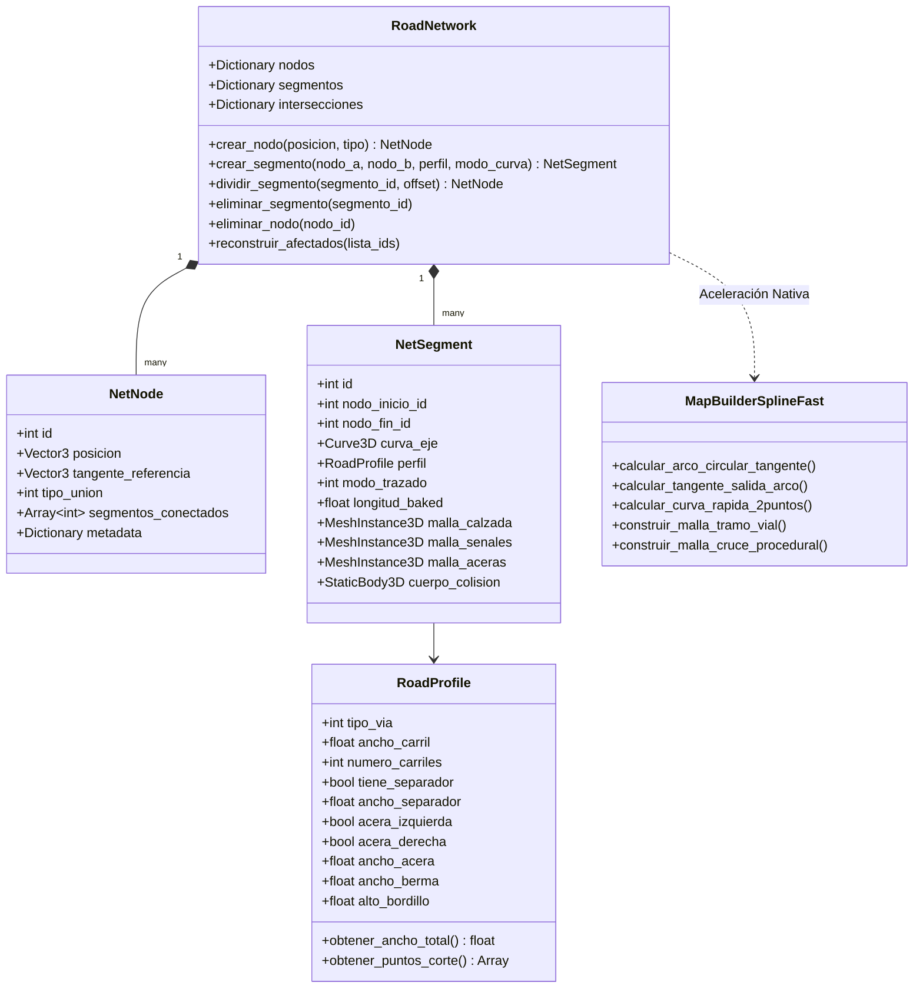
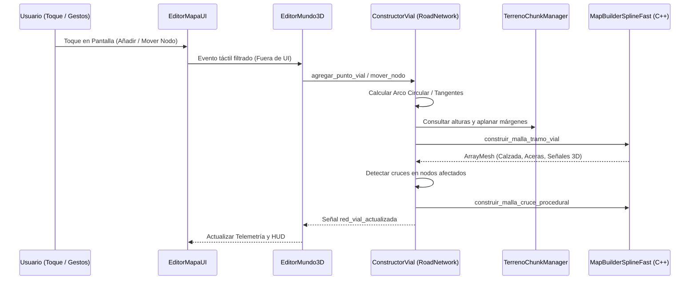

# ARQUITECTURA TÉCNICA DEL SISTEMA DE CARRETERAS
## Nuestra Tierra 2.0 — Red Vial Paramétrica y Topología de Red

---

### 1. Principios de Diseño Arquitectónico

1. **Separación de Capas:** La lógica matemática y topológica de la red vial es completamente agnóstica de la interfaz de usuario y del renderizado.
2. **Topología de Grafo Explícita:** La red se estructura como un grafo conexo orientado donde las entidades fundamentales son **Nodos** (`NetNode`) y **Segmentos** (`NetSegment`).
3. **Generación Geométrica Determinista:** A partir de los parámetros del nodo, la curva y el perfil transversal, la geometría (`ArrayMesh`) se reconstruye de forma predecible sin depender del historial de clics del usuario.
4. **Desempeño Híbrido (Dual-Path C++ / GDScript):** Los cálculos de alta intensidad (discretización de arcos, cálculo de frames ortonormales, triangulación y ensamble de buffers de vértices) se ejecutan a nivel nativo en C++ (`MapBuilderSplineFast`) con fallback transparente en GDScript para entornos de depuración.

---

### 2. Diagrama de Arquitectura y Clases



---

### 3. Modelo Matemático de Trazado de Curvas

#### 3.1. Arco Circular de Radio Constante por Tangente de Entrada
Dado un punto de inicio $P_0$, un punto final $P_1$, y un vector tangente unitario de entrada $\vec{T}_0$ (determinado por el tramo anterior o alineado por el usuario):
1. Vector cuerda en el plano horizontal $XZ$:
   $$\vec{C} = (P_1 - P_0)_{xz}, \quad L = \|\vec{C}\|, \quad \vec{u}_c = \frac{\vec{C}}{L}$$
2. Ángulo de deflexión $\alpha$ entre la tangente inicial $\vec{T}_0$ y la cuerda $\vec{u}_c$:
   $$\sin(\alpha) = (\vec{T}_0 \times \vec{u}_c)_y, \quad \cos(\alpha) = \vec{T}_0 \cdot \vec{u}_c, \quad \alpha = \operatorname{atan2}(\sin\alpha, \cos\alpha)$$
3. Si $|\alpha| < 0.015\text{ rad}$, el tramo se considera una recta perfecta.
4. Para arcos reales, el radio constante de curvatura $R$ es:
   $$R = \frac{L}{2 |\sin\alpha|}$$
5. El centro de curvatura $O$ se ubica desplazándose perpendicularmente a la tangente:
   $$\vec{N}_0 = \operatorname{sign}(\alpha) \cdot (-\vec{T}_{0,z}, 0, \vec{T}_{0,x}), \quad O = P_0 + R \vec{N}_0$$
6. El ángulo total del arco subtendido es $\theta_{\text{total}} = 2 |\alpha|$. Para cualquier parámetro $u \in [0, 1]$:
   $$P(u) = O - R \cos(u \cdot \theta_{\text{total}}) \vec{N}_0 + R \sin(u \cdot \theta_{\text{total}}) \vec{T}_0 + \left(0, \operatorname{lerp}(P_{0,y}, P_{1,y}, u), 0\right)$$
7. **Tangente Unitaria de Salida $\vec{T}_1$:**
   $$\vec{T}_1 = 2 (\vec{T}_0 \cdot \vec{u}_c) \vec{u}_c - \vec{T}_0$$
   Esta fórmula exacta permite encadenar arcos sucesivos en **2 clics continuos** garantizando continuidad $C^1$ impecable.

---

### 4. Ciclo de Vida y Reconstrucción por Dependencias



---

### 5. Estructura de Persistencia (.ntmap)

El modelo topológico se guarda en formato JSON comprimido en la sección `"red_vial"`:
```json
{
  "version": 2.0,
  "nodos": [
    { "id": 1, "pos": [120.5, 5.0, -84.2], "tipo_union": 0, "segmentos": [101, 102] }
  ],
  "segmentos": [
    {
      "id": 101,
      "nodo_inicio": 1,
      "nodo_fin": 2,
      "tipo_via": 0,
      "modo_curva": 2,
      "es_puente": false,
      "con_acera_izq": false,
      "con_acera_der": false,
      "ancho_acera": 2.0,
      "puntos_curva": [[120.5, 5.0, -84.2], [145.2, 5.0, -60.1]]
    }
  ]
}
```
Esta especificación mantiene retrocompatibilidad completa con los mapas previamente guardados y permite reconstruir la red en cualquier plataforma sin pérdida de precisión.
