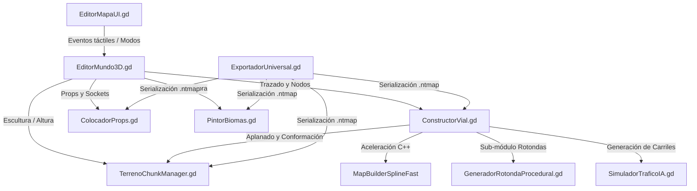

# AUDITORÍA TÉCNICA DEL EDITOR DE MAPAS EXISTENTE
## Nuestra Tierra 2.0 — Sistema de Edición y Creación de Mundos

---

### 1. Resumen Ejecutivo y Objetivo

El proyecto **Nuestra Tierra 2.0** cuenta con un editor de mapas 3D interactivo en desarrollo orientado principalmente a dispositivos móviles Android y PC. La presente auditoría examina la totalidad del subsistema existente para fundamentar su evolución técnica sin reescribir ni destruir componentes funcionales, asegurando máxima compatibilidad arquitectónica.

---

### 2. Estructura de Carpetas e Inventario de Componentes

```
nuestra-tierra-2.0/
├── codigo/
│   └── sistemas/
│       └── editor_mapas/
│           ├── ConstructorVial.gd            # Motor de trazado spline, extrusión de calzadas e intersecciones
│           ├── EditorMundo3D.gd              # Controlador de escena 3D, cámara táctil, selección y gizmos
│           ├── GeneradorRotondaProcedural.gd # Generador procedural de glorietas y rotondas
│           ├── TerrenoChunkManager.gd        # Sistema de terreno por chunks con escultura y adaptación
│           ├── ColocadorProps.gd             # Colocación, empalme de sockets y transformación de props
│           ├── PintorBiomas.gd               # Pintado de splatmap y dispersión de vegetación
│           ├── SimuladorTraficoIA.gd         # Simulación de tráfico vehicular y carriles IA
│           ├── UltraGeneradorMapas.gd        # Generador de presets procedimentales de paisajes
│           ├── ExportadorUniversal.gd        # Serializador DEFLATE (.ntmap) y exportador a .tscn
│           ├── GestorProyectoMapas.gd        # Metadatos del mapa, autoría y configuración de proyecto
│           ├── GestorMultijugadorMapas.gd    # Sincronización multiusuario y cursores remotos
│           ├── CatalogoPropsNT.gd            # Diccionario y catálogo de assets colombianos
│           └── native/                       # Extensiones nativas C++ (godot-cpp / GDExtension)
│               ├── map_builder_spline_fast.h / .cpp
│               ├── rotonda_procedural_fast.h / .cpp
│               ├── register_types.h / .cpp
│               └── SConstruct
└── interfaz/
    └── editor_mapas/
        ├── EditorMapaUI.gd                   # Interfaz de usuario adaptativa táctil (Glassmorphism)
        └── EditorMapaUI.tscn                 # Jerarquía de nodos UI (CanvasLayer)
```

---

### 3. Diagnóstico de Módulos y Dependencias



#### 3.1. `ConstructorVial.gd`
- **Responsabilidad actual:** Trazado de vías mediante `Curve3D`, cálculo de frames ortonormales Frenet-Serret bisectados, extrusión procedural de mallas (`ArrayMesh`) para calzada, aceras, bordillos, losa inferior de puentes y pilares estructurales. Detección geométrica de cruces y generación de glorietas.
- **Puntos Fuertes:** Soporte nativo Dual-Path (aceleración C++ `MapBuilderSplineFast` con fallback transparente en GDScript), protección miter contra auto-intersecciones en curvas cerradas, integración de señalización 3D procedural (líneas blancas y amarillas mate).
- **Áreas de Evolución:** Falta de un grafo topológico formal (`NetNode` y `NetSegment`) desacoplado; actualmente cada carretera es un nodo `Path3D` individual y las intersecciones se reconstruyen por proximidad en lugar de por pertenencia topológica persistente.

#### 3.2. `EditorMundo3D.gd`
- **Responsabilidad actual:** Gestión de cámara RTS táctil, diferenciación precisa de gestos (1 dedo para órbita, 2 dedos para zoom/paneo con deadzone de 24px contra arrastres involuntarios), raycasting contra capas de física del terreno y de los nodos viales, visualización de gizmos 3D y retícula flotante.
- **Puntos Fuertes:** Muy robusto contra falsos toques; incluye cola Undo/Redo funcional y HUD 3D de elevación con ajuste en incrementos de 0.5m.

#### 3.3. `TerrenoChunkManager.gd`
- **Responsabilidad actual:** Terreno basado en heightmaps divididos en cuadrículas/chunks con cálculo dinámico de normales. Dispone de las funciones `adaptar_terreno_a_curva(curva, ancho, talud, es_puente)` y `aplanar_manzana(perimetro_xz, altura, margen)`.
- **Compatibilidad:** Excelente integración geométrica. Las carreteras pueden muestrear `get_altura_en(x, z)` y aplanar márgenes sin modificar la estructura interna de los chunks.

#### 3.4. `ExportadorUniversal.gd`
- **Responsabilidad actual:** Serialización binaria comprimida DEFLATE en formato `.ntmap` (<1.5 MB) y exportación limpia a escenas Godot `.tscn` asignando capas de colisión de vehículos pesados (Layer 1 + Layer 3).
- **Compatibilidad:** Debe mantenerse retrocompatibilidad total con el formato `NT_MAP_V2` ampliando la clave `"red_vial"`.

---

### 4. Plan de Integración Técnica
1. **Mantener intacta la API pública** de `ConstructorVial.gd` para que ni `EditorMundo3D.gd` ni `EditorMapaUI.gd` ni `ExportadorUniversal.gd` sufran regresiones.
2. **Introducir la estructura topológica desacoplada** de Nodos y Segmentos dentro del motor procedural, permitiendo manipulación individual de nodos (mover, cambiar tangente, dividir segmento, fusionar nodos).
3. **Evolucionar el sistema de intersecciones** de un modelo de detección por barrido a un modelo de nodo conector paramétrico con esquinas suavizadas mediante fillets basados en radio y ángulo bisector.
4. **Optimizar la interfaz táctil** asegurando que los controles contextuales sigan los lineamientos ergonómicos móviles de Nuestra Tierra 2.0.
