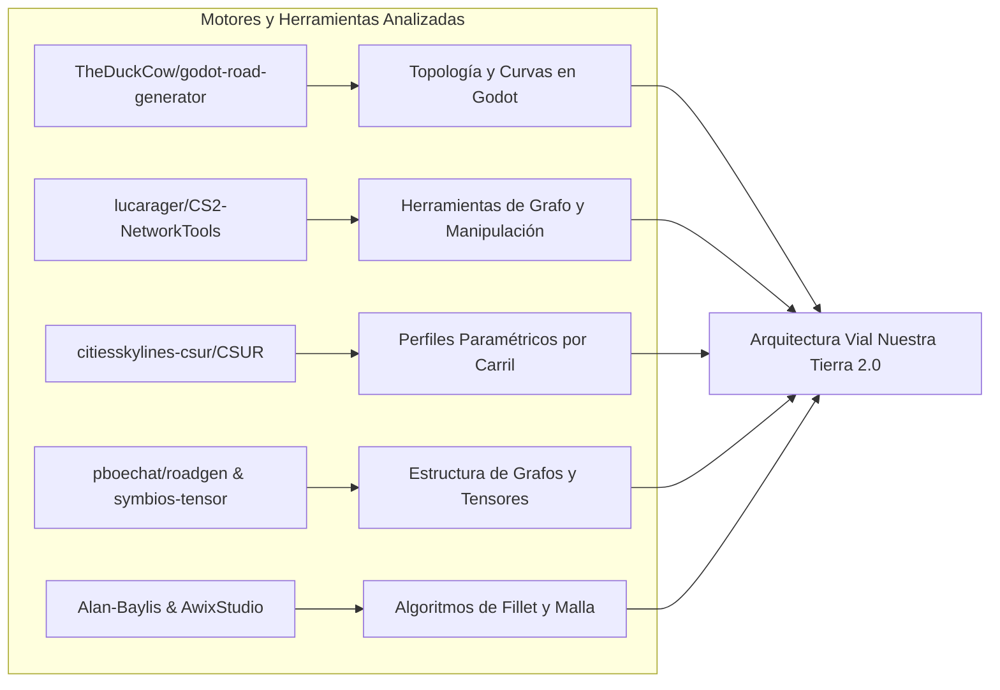

# INVESTIGACIÓN MEDIANTE INGENIERÍA INVERSA (REA)
## Análisis Comparativo de Sistemas de Generación Procedural Vial

---

### 1. Marco de la Investigación

Para el desarrollo del nuevo sistema vial de **Nuestra Tierra 2.0**, se realizó una investigación en profundidad mediante Ingeniería Inversa y Análisis Arquitectónico (REA) sobre las soluciones de código abierto y estándares de la industria más influyentes.

---

### 2. Análisis Detallado de Proyectos

#### 2.1. `TheDuckCow/godot-road-generator` (Godot 4)
- **Concepto Central:** Sustituye el uso frágil de `CSGPolygon3D` por una arquitectura basada en `RoadContainer` y `RoadPoint`. Cada `RoadPoint` define una sección transversal local con control individual de número de carriles, anchuras, bermas y peraltes.
- **Lección Extraída para Nuestra Tierra:**
  - Los tramos viales deben mantener perfiles bisectados calculados mediante los vectores ortonormales en cada corte transversal ($\vec{T}$, $\vec{N}$, $\vec{B}$).
  - Las intersecciones se resuelven cortando las calzadas que ingresan y generando una malla poligonal central que sella los extremos sin dejar grietas ni solapamientos.

#### 2.2. `lucarager/CS2-NetworkTools` (Cities: Skylines 2)
- **Concepto Central:** Implementado sobre Unity ECS / Burst con interfaz reactiva táctil. Proporciona herramientas de precisión sobre redes de transporte:
  - **Add Node:** Divide un segmento en un punto arbitrario preservando la curvatura y creando un nodo intermedio manipulable.
  - **Remove Node:** Elimina un nodo intermedio recalculando una curva continua $C^1$ entre los nodos adyacentes.
  - **Super Node:** Fusiona múltiples nodos próximos en una macro-intersección unificada, recalculando el perímetro convexo y los cortes de boca de todos los ramales.
  - **Parallel Network:** Genera trayectorias paralelas desplazando la curva mediante el vector normal horizontal:
    $$\vec{P}_{\text{par}}(s) = \vec{P}(s) \pm d \cdot \vec{N}(s)$$
  - **Slope Profiling:** Modela la rasante vertical $z(s)$ de forma independiente de la alineación horizontal $XY$, garantizando pendientes máximas viables para vehículos pesados.

#### 2.3. `citiesskylines-csur/CSUR` (Sistema Modular de Perfiles)
- **Concepto Central:** En lugar de tratar una carretera como una malla rígida prefabricada, CSUR descompone la sección transversal en componentes modulares:
  - Carril individual ($3.65\text{m}$ estándar internacional / INVÍAS).
  - Separador central o barrera New Jersey.
  - Berma exterior y cuneta de drenaje.
  - Franja de andén y bordillo urbano.
- **Lección Extraída para Nuestra Tierra:**
  - Parametrizar la sección transversal como una lista de componentes desplazables lateralmente respecto al eje axial. Esto permite crear perfiles asimétricos, transiciones de carriles y autopistas multicarril sin duplicar código de geometría.

#### 2.4. `Alan-Baylis/Unity-Road-Generator` y `AwixStudio/Road-System` (Algoritmos de Intersección)
- **Geometría de Empalmes y Fillets:**
  - Cuando dos carreteras de anchos $W_1$ y $W_2$ se cruzan formando un ángulo de deflexión $\theta$, la esquina sharp generaría un pico visualmente irreal.
  - Se calcula el empalme de redondeo (**Fillet**) mediante la tangente del ángulo mitad:
    $$T = \frac{R}{\tan(\theta / 2)}$$
    donde $R$ es el radio mínimo de giro (e.g. $4.0\text{–}6.0\text{m}$ para camiones de carga).
  - La esquina viva se reemplaza por un arco discretizado que une suavemente la calzada $k$ con la calzada $k+1$.

---

### 3. Matriz Comparativa de Capacidades

| Capacidad Técnica | Vanilla CS1 | CSUR | Godot Road Gen | CS2 NetworkTools | **Nuestra Tierra 2.0 (Objetivo)** |
| :--- | :---: | :---: | :---: | :---: | :---: |
| **Topología Nodos/Segmentos** | Sí | Sí | Sí | Sí | **Sí (Grafo Dinámico)** |
| **Curvas Circulares 2 Clics** | Parcial | No | No | Sí | **Sí (Motor C++ Nativo)** |
| **Intersección Multirramal** | Prefab | Scripting | Procedural | ECS Procedural | **Procedural Paramétrica** |
| **Fillet Adaptativo en Curvas** | Rígido | Rígido | Manual | Dinámico | **Automático C++** |
| **Señalización 3D Procedural** | Textura | Textura | Textura | Malla / Calcomanía | **Malla 3D Mate Elevada** |
| **Control Táctil Móvil** | No | No | No | No | **Sí (Optimizado Android)** |
| **Integración con Terreno** | Altura fija | Malla aislada | Raycast básico | ECS Terreno | **Heightmap Chunks + Talud** |

---

### 4. Conclusiones y Selección de Patrones de Diseño
1. Se adopta la **separación de responsabilidades** entre la capa de topología (grafo vial), la capa de generación geométrica (extrusión procedural y triangulación de intersecciones) y la capa de presentación/interacción (UI táctil móvil).
2. Se implementa el algoritmo de **Fillets Angulares Bisectores** para que cualquier cruce (de 2 a 8 brazos, en ángulo oblicuo o recto) genere bordillos suaves y calzadas continuas sin agujeros.
3. Se mantiene el soporte **Dual-Path C++ / GDScript** para garantizar el máximo rendimiento en teléfonos de gama media y alta.
