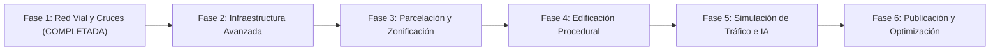

# HOJA DE RUTA TÉCNICA (ROADMAP): DE GENERADOR VIAL A CONSTRUCTOR URBANO PROCEDURAL

## Visión General
Transformar el editor de mapas de *Nuestra Tierra 2.0* en un constructor de ciudades y mundos procedurales de clase mundial, optimizado para dispositivos móviles y ambientado en la identidad geográfica y urbana de América Latina y Colombia.

---

## Fase 1: Núcleo de Red Vial e Intersecciones Procedurales *(ESTADO: COMPLETADA)*
- [x] Motor matemático dual C++ GDExtension (`MapBuilderSplineFast`) y GDScript.
- [x] Trazado de arcos circulares de radio constante en 2 clics (inspirado en Cities: Skylines 2).
- [x] Corrección de solapamiento y duplicación de carreteras en trazado encadenado.
- [x] Unificación de texturas PBR de asfalto y hormigón con mapeo de coordenadas UV proyectadas en espacio de mundo.
- [x] Señalización horizontal procedural 3D (líneas continuas, discontinuas y dobles elevadas con rugosidad mate).
- [x] Generador de intersecciones multi-brazo automáticas con corte de calzadas ($D_{\text{arm}}$), acordamientos fillet circulares y polígonos centrales continuos.
- [x] Adaptación a la guía de diseño Glassmorphic Cockpit y ergonomía táctil móvil.

---

## Fase 2: Infraestructura Vial Avanzada y Obras Civiles *(ESTADO: PRÓXIMA)*
- [ ] **Rotondas Automáticas (Roundabouts):** Conversión de un nodo o cruce existente en una rotonda con isleta central ajardinada, radio regulable (12m a 35m) y carriles concéntricos con señalización de ceda el paso.
- [ ] **Carriles de Incorporación y Salida (Slip Lanes / Rampas):** Ensanchamiento y bifurcación procedural de calzadas sin interrumpir el flujo del tronco principal.
- [ ] **Generador de Puentes y Viaductos:**
  - Detección automática de altura sobre el terreno ($h > 3.5\text{ m}$).
  - Creación procedural de tableros de concreto, barandas de seguridad metálicas y pilares cilíndricos/rectangulares anclados al terreno base.
- [ ] **Generador de Portales de Túnel:** Perforación visual del terreno mediante recorte de heightmap y adición de emboquilles de túnel en pendientes abruptas.
- [ ] **Señalización Vertical y Mobiliario Vial:** Colocación automática de postes reflectivos, señales de límite de velocidad y semáforos en esquinas de cruce.

---

## Fase 3: Cuadrícula de Zonificación y Parcelación Urbana *(ESTADO: PLANIFICADA)*
- [ ] **Rejilla Dinámica de Parcelas (Zoning Grid CS2 Style):**
  - Proyección de celdas cuadradas de $8\text{ m} \times 8\text{ m}$ perpendiculares a los bordes de acera de cada carretera.
  - Gestión de curvatura: celdas trapezoidales y sectores angulares con fusión de parcelas en radios cerrados.
- [ ] **Pinceles Táctiles de Zonificación:**
  - Residencial de baja y media densidad (viviendas familiares, casas de barrio).
  - Comercial y servicios (tiendas de esquina, supermercados, talleres).
  - Industrial y logística (bodegas, centros de acopio).
  - Institucional y espacios públicos (parques, plazas, escuelas).
- [ ] **Servidumbres y Retiros de Vía:** Espacios peatonales obligatorios según la jerarquía vial (avenida vs. calle barrial).

---

## Fase 4: Edificación Procedural y Contexto Colombiano / Latinoamericano *(ESTADO: PLANIFICADA)*
- [ ] **Motor de Ensamblado Procedural de Lotes:**
  - Algoritmo que selecciona modelos modulares de fachadas, cubiertas de teja o losa, patios interiores y antejardines según el tamaño del lote delimitado.
  - Variación de materiales: ladrillo a la vista, estuco pintado de colores vivos, balcones y rejas ornamentales.
- [ ] **Mobiliario Urbano Típico:**
  - Paraderos de autobús, canecas de basura públicas, árboles nativos (guayacanes, palmas, acacias) a lo largo de las aceras.
  - Alumbrado público con farolas coloniales y postes de hormigón con cableado aéreo procedural opcional.

---

## Fase 5: Simulación de Tráfico Vehicular, Rutas y Peatones *(ESTADO: FUTURA)*
- [ ] **Grafo de Navegación Vial Directo:**
  - Generación automática de aristas y curvas de navegación vehicular a partir de los marcos Frenet de cada carril y de las curvas de giro en las intersecciones.
- [ ] **IA de Conducción Ligera para Móviles:**
  - Cinemática de seguimiento de línea (*Pure Pursuit / Stanley Steering Controller*).
  - Comportamiento de parada en semáforos, respeto de prioridades en rotondas y colas de vehículos no superpuestas.
- [ ] **Flujo Peatonal:** Cruce de peatones por cebras y caminata a lo largo de las aceras generadas.

---

## Fase 6: Optimización Extrema, Guardado en la Nube y Exportación *(ESTADO: CONTINUA)*
- [ ] **Serialización Compacta y Servidor:** Sincronización en tiempo real con el backend de *servidor Nuestra Tierra* para compartir mapas creados por la comunidad.
- [ ] **Herramienta de Captura y Fotografía Urbana:** Modo libre de cámara para capturar postales cinematográficas de las ciudades diseñadas con filtros atmosféricos y hora del día variable.
- [ ] **Pruebas de Compatibilidad Android:** Certificación de rendimiento a 60 FPS en SoC Snapdragon 7xx/8xx y MediaTek Dimensity.
