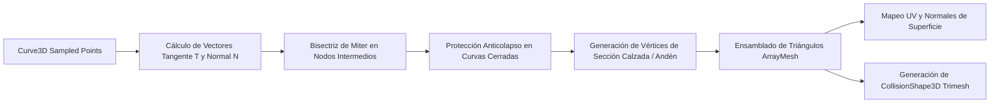

# SISTEMA DE GENERACIÓN PROCEDURAL DE GEOMETRÍA VIAL
## Mallas 3D, Frames Ortonormales, Coordenadas UV, Materiales y Colisiones

---

### 1. Extrusión de Secciones Transversales a lo Largo de Curvas 3D

Para convertir una curva matemática discreta en una vía tridimensional transitable por tractomulas y vehículos de carga, el sistema ejecuta una extrusión procedural de secciones transversales a lo largo de los puntos de la curva.



---

### 2. Marco Móvil Ortonormal y Bisectriz de Miter

En cada punto $P_i$ de la trayectoria:
1. **Tangentes hacia atrás y adelante:**
   $$\vec{t}_{\text{prev}} = \frac{P_i - P_{i-1}}{\|P_i - P_{i-1}\|}, \quad \vec{t}_{\text{next}} = \frac{P_{i+1} - P_i}{\|P_{i+1} - P_i\|}$$
2. **Normales horizontales:**
   $$\vec{n}_{\text{prev}} = (-\vec{t}_{\text{prev}, z}, 0, \vec{t}_{\text{prev}, x}), \quad \vec{n}_{\text{next}} = (-\vec{t}_{\text{next}, z}, 0, \vec{t}_{\text{next}, x})$$
3. **Bisectriz de Miter:**
   $$\vec{n}_{\text{bisect}} = \frac{\vec{n}_{\text{prev}} + \vec{n}_{\text{next}}}{\|\vec{n}_{\text{prev}} + \vec{n}_{\text{next}}\|}$$
4. **Factor de Escala Miter:**
   $$M = \frac{1}{\sqrt{\frac{1 + \vec{n}_{\text{prev}} \cdot \vec{n}_{\text{next}}}{2}}}$$
   Para prevenir aristas punzocortantes en giros agudos, se acota $M \in [1.0, 1.28]$.

#### 2.1. Protección del Lado Interior de la Curva (Anti-Pinch)
En curvas cerradas, el lado interior se comprime mientras que el exterior se expande. Si el radio de curvatura es menor al semi-ancho de la vía, los triángulos interiores se cruzan e invierten sus normales.
El sistema calcula el producto vectorial de curvatura $C_y = (\vec{t}_{\text{prev}} \times \vec{t}_{\text{next}})_y$:
- Si $C_y > 0.02$ (curva a la izquierda): el lado izquierdo es el interior, por lo que su escala lateral se ajusta a:
  $$S_{\text{izq}} = \operatorname{clamp}\left(\frac{1}{M}, 0.72, 1.0\right), \quad S_{\text{der}} = M$$
- Si $C_y < -0.02$ (curva a la derecha):
  $$S_{\text{der}} = \operatorname{clamp}\left(\frac{1}{M}, 0.72, 1.0\right), \quad S_{\text{izq}} = M$$

---

### 3. Anatomía del Perfil Transversal

Cada perfil vial genera superficies independientes dentro de un único `ArrayMesh`:

```
               [Separador New Jersey]
                      +0.62m
                        /\
           +0.04m      /  \      +0.04m                  +0.18m (Andén)
[Cuneta]  [Calzada]   /    \    [Calzada]   [Bordillo]   [Superficie Peatonal]
  \______/~~~~~~~~~~~+      +~~~~~~~~~~~~~~\_______+=====================+
         <- Carril Izq ->   <- Carril Der ->
```

1. **Superficie 0: Calzada Principal**
   - Altura base: $y = 0.04\text{m}$ con bombeo central suave ($y = 0.06\text{m}$) para escorrentía pluvial.
   - Material: `material_asfalto` (PBR con textura de concreto/asfalto unificada).
2. **Superficie 1: Aceras y Bordillos**
   - Bordillo de concreto con cara inclinada ($y = 0.04\text{m} \to 0.18\text{m}$) y cara superior del andén de ancho configurable ($0.8\text{–}6.0\text{m}$).
   - Material: `material_acera`.
3. **Superficie 2: Losa Inferior Estructural (Viaductos y Puentes)**
   - Cuando la cota respecto al suelo es $\ge 2.5\text{m}$, se genera una losa cajón de concreto en el intradós con faldones a $45^\circ$.
   - Material: `material_pilar`.
4. **Superficies 3 y 4: Señalización Horizontal 3D Procedural**
   - Geometría de cinta elevada $+0.054\text{m}$ a $+0.074\text{m}$.
   - Superficie 3: Señalización blanca mate (`material_pintura_vial`).
   - Superficie 4: Señalización amarilla mate INVÍAS (`material_lineas`).

---

### 4. Mapeo UV y Texturizado PBR

- **UV Planar en Espacio de Mundo para Calzada y Cruces:**
  Para eliminar cualquier corte visible entre tramos rectos, tramos curvos y plazas de intersección:
  $$\text{UV} = \begin{pmatrix} X \cdot 0.25 \\ Z \cdot 0.25 \end{pmatrix}$$
- **UV Longitudinal Paramétrico para Bordillos y Señales:**
  $$\text{UV} = \begin{pmatrix} u_{\text{transversal}} \\ s_{\text{acumulado}} \cdot 0.5 \end{pmatrix}$$
- **Configuración de Materiales:**
  - Base Albedo: Tonos calibrados de concreto asfáltico gris carbón `Color(0.24, 0.25, 0.26)`.
  - Normal Map: Relieve de grava asfáltica comprimida con factor de escala $1.25$.
  - Rugosidad: $0.88\text{–}0.94$, `metallic = 0.0`, `metallic_specular = 0.12` para eliminar cualquier brillo plástico irreal.

---

### 5. Generación de Cuerpos de Colisión (`StaticBody3D`)

Para soportar las físicas de tractomulas y vehículos de alta masa de Nuestra Tierra:
1. Se genera una forma tridimensional trimesh precisa:
   ```gdscript
   var col_shape := CollisionShape3D.new()
   col_shape.shape = mesh_calzada.create_trimesh_shape()
   ```
2. **Capas de Física Específicas:**
   - `collision_layer = (1 << 0) | (1 << 2)` (Bits 1 y 3: Capa 1 Mundo general + Capa 3 Superficie de Rodadura Asfalto INVÍAS).
   - `collision_mask = (1 << 1)` (Detecta vehículos pesados en Capa 2).
   Esto permite que el sistema de suspensión y fricción de llantas (`llanta_pesada.gd`) identifique que está rodando sobre asfalto óptimo con coeficiente de fricción $\mu = 0.95$.
