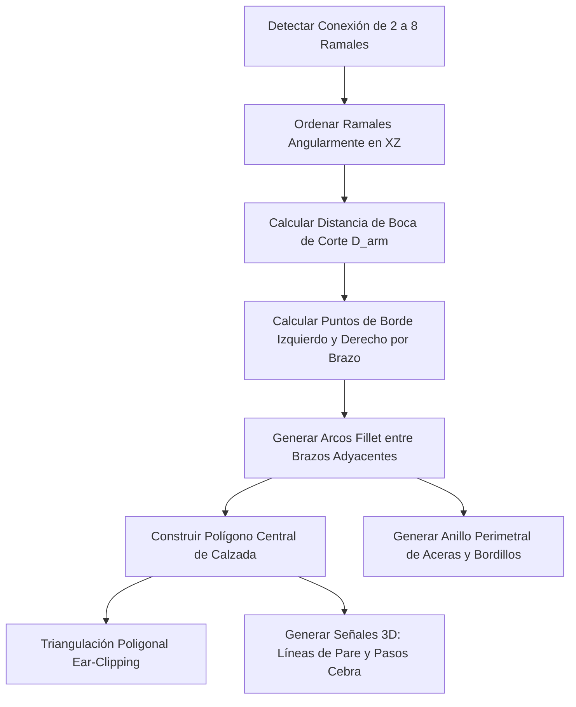

# SISTEMA DE INTERSECCIONES AUTOMÁTICAS PROCEDURALES
## Nuestra Tierra 2.0 — Geometría Adaptativa Multirramal y Rotondas

---

### 1. Filosofía de Diseño: Adiós a los Modelos Prefabricados Rígidos

Las intersecciones en los simuladores modernos (como *Cities: Skylines 2*) no son piezas estáticas 3D premodeladas. En el mundo real, los cruces tienen ángulos variables, ramales de diferentes anchos, perfiles con o sin andén y rasantes asimétricas. 

El sistema de **Nuestra Tierra 2.0** genera las intersecciones mediante **cálculo geométrico paramétrico en tiempo de ejecución**, garantizando:
- Sellado perfecto con las carreteras conectadas (cero grietas o agujeros).
- Continuidad de textura de asfalto y concreto (mismo UV planar y mismo material PBR).
- Esquinas redondeadas (**Fillets**) basadas en radios de curvatura reales para transporte pesado.
- Andenes perimetrales y señalización horizontal colombiana (INVÍAS).



---

### 2. Algoritmo Paso a Paso de Generación de Intersección

#### Paso 1: Extracción y Ordenamiento Radial de Ramales
Para una intersección ubicada en $P_{\text{cruce}}$, se recopilan todos los segmentos concurrentes. Para cada segmento $k$:
1. Se determina el vector tangente director $\vec{u}_k$ que apunta alejándose del centro del cruce en el plano horizontal $XZ$.
2. Se calcula su ángulo acimutal $\phi_k = \operatorname{atan2}(u_{k,z}, u_{k,x})$.
3. Se ordena la lista de brazos de modo que $\phi_0 < \phi_1 < \dots < \phi_{N-1}$.

#### Paso 2: Cálculo de Distancia de Corte de Boca ($D_{\text{arm}}$)
Para evitar que las esquinas colapsen entre dos carreteras anchas o con ángulos agudos:
$$D_{\text{arm}} = \max_{k} (W_{\text{total}, k}) + R_{\text{fillet}}$$
donde $W_{\text{total}, k}$ es el semi-ancho total de la carretera $k$ (calzada + berma/andén) y $R_{\text{fillet}}$ es el radio de giro de la esquina (típicamente $3.8\text{–}4.5\text{m}$).

La boca de corte de cada carretera se ubica en el punto exacto sobre la curva a distancia $D_{\text{arm}}$:
$$P_{\text{boca}, k} = P_{\text{cruce}} + \vec{u}_k \cdot D_{\text{arm}}$$

#### Paso 3: Puntos de Calzada y Arcos de Esquina (Fillets)
Para cada brazo $k$, el vector perpendicular horizontal es $\vec{R}_k = \vec{u}_k \times \vec{Y}_{\text{up}}$:
- Borde derecho de calzada: $B_{R, k} = P_{\text{boca}, k} + \vec{R}_k \cdot w_{\text{calzada}, k}$
- Borde izquierdo de calzada: $B_{L, k} = P_{\text{boca}, k} - \vec{R}_k \cdot w_{\text{calzada}, k}$

Entre el borde derecho del brazo $k$ ($B_{R, k}$) y el borde izquierdo del siguiente brazo $k+1$ ($B_{L, k+1}$):
1. Se calcula el producto escalar de tangentes $\cos\theta = \vec{u}_k \cdot \vec{u}_{k+1}$.
2. Se generan los puntos de control de Bézier cúbico o arco circular con factor de miter:
   $$\text{handle\_len} = \|B_{L, k+1} - B_{R, k}\| \cdot \operatorname{lerp}(0.38, 0.28, \max(0, -\cos\theta))$$
   $$\vec{C}_1 = B_{R, k} - \vec{u}_k \cdot \text{handle\_len}, \quad \vec{C}_2 = B_{L, k+1} + \vec{u}_{k+1} \cdot \text{handle\_len}$$
3. Se evalúan 12 pasos a lo largo de la curva para formar el fillet continuo de la esquina.

```
       Brazo k
         ||
         ||  B_R,k
         ||   *--------- Fillet (Arco Suave) --------* B_L,k+1
         ||                                          ||
      Centro (P_cruce)                               ||
                                                     ||  Brazo k+1
```

#### Paso 4: Triangulación y Mapeo UV Planar Continuo
El polígono de la calzada queda delimitado por la concatenación cíclica de los bordes de boca y los arcos de fillet.
- **Triangulación:** Se utiliza el algoritmo de triangulación de polígonos simples (`Geometry2D.triangulate_polygon`), con limpieza previa de micro-vértices duplicados ($d^2 < 0.0025\text{ m}^2$) para garantizar triangulaciones estables sin caras degeneradas.
- **UV Planar en Espacio de Mundo:** Para que el asfalto del cruce coincida exactamente con la calzada de los tramos conectados sin líneas divisorias:
  $$\text{UV} = (P_x \cdot 0.25, P_z \cdot 0.25)$$
  Con esto, una carretera que llega a la intersección se funde visualmente con cero artefactos.

---

### 3. Generación de Aceras y Bordillos Perimetrales

En intersecciones con andenes (urbanas):
1. Se toma el arco de calzada $A_{\text{calzada}}(t)$ y el arco exterior del andén $A_{\text{exterior}}(t)$.
2. En cada punto $i$ del arco se calcula la dirección radial normal hacia el exterior.
3. Se generan 4 vértices por corte transversal:
   - $V_0$: Nivel de calzada ($y = 0.04\text{m}$).
   - $V_1$: Cara superior del bordillo ($y = 0.18\text{m}$).
   - $V_2$: Borde exterior superior del andén ($y = 0.18\text{m}$).
   - $V_3$: Caída exterior hacia el terreno ($y = -0.06\text{m}$).
4. Se generan las quads correspondientes con material `material_acera`, logrando esquinas de manzana perfectamente redondeadas.

---

### 4. Señalización Horizontal Procedural 3D en Intersecciones

El sistema genera automáticamente:
- **Línea de Detención (Stop Bar):** Línea blanca continua de $0.42\text{m}$ de ancho perpendicular al eje del ramal, ubicada a $0.55\text{m}$ hacia el interior de la boca del cruce.
- **Paso Peatonal (Cebra Urbana):** En vías con andén, genera franjas rectangulares blancas de $0.44\text{m} \times 2.10\text{m}$ distribuidas a lo largo de la calzada de entrada.
- **Líneas de Guía de Giro:** Cinta blanca de $0.16\text{m}$ a lo largo de los fillets interiores.
- **Materialidad:** Toda la señalización se renderiza como malla 3D elevada $+0.054\text{m}$ sobre el pavimento con acabado mate (no reflectivo, rugosidad $0.94$), eliminando el parpadeo de z-fighting.

---

### 5. Rotondas y Glorietas Procedurales

Las rotondas son un caso especial de macro-nodo donde el tráfico gira alrededor de una isla central:
- **Isla Central:** Radio interior configurable ($R_{\text{int}} \in [4.0, 30.0]\text{m}$) con bordillo elevado de concreto y relleno de césped/tierra.
- **Anillo de Circulación:** Ancho proporcional al número de carriles configurados ($3.8\text{m}$ por carril).
- **Conexión de Brazos Tangenciales:** Los ramales de entrada entran con curvas de transición tangenciales al anillo exterior de la rotonda, calculadas en `GeneradorRotondaProcedural.gd`.
